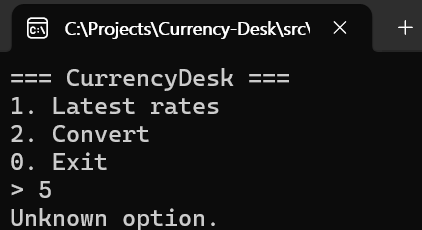
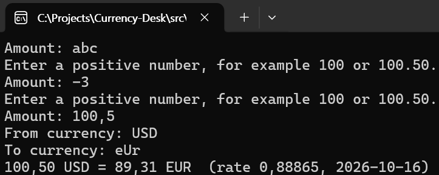
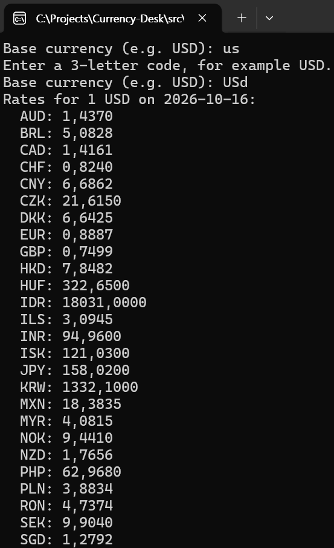
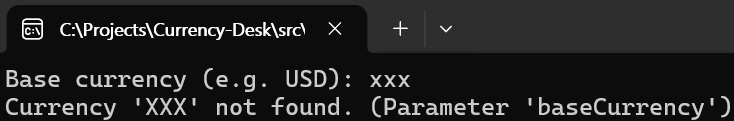
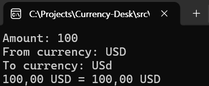
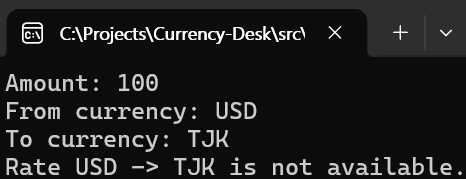
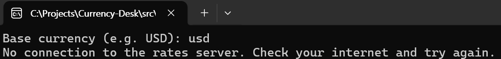

# CurrencyDesk

A console currency converter built with C# and .NET, using live exchange rates
from the [Frankfurter API](https://www.frankfurter.app/) (European Central Bank data).


## Features

- **Latest exchange rates** for any supported base currency, sorted by code
- **Currency conversion** with validated input and explicit rounding
- **Graceful error handling** — network errors, timeouts and unknown currencies
  show a clear message instead of crashing the app
- **Unit tests** for input parsing and conversion logic (xUnit)

## Screenshot















## Example session

```
=== CurrencyDesk ===
1. Latest rates
2. Convert
0. Exit
> 2
Amount: 100,5
From currency: usd
To currency: eur
100.50 USD = 89.31 EUR  (rate 0.88865, 2026-10-16)
```

## Tech stack

- C# / .NET 10
- `HttpClient` + `System.Text.Json` for the REST API
- xUnit for unit tests

## Project structure

```
CurrencyDesk/
├─ src/CurrencyDesk/
│  ├─ Clients/     FrankfurterClient — HTTP requests to the rates API
│  ├─ Models/      API response models (LatestRates, RatesHistory)
│  ├─ Services/    Pure logic: InputParser, CurrencyConverter
│  ├─ UI/          ConsoleMenu — user interaction and error handling
│  └─ Program.cs   Composition: creates HttpClient, client and menu
└─ tests/CurrencyDesk.Tests/
   └─ Services/    Unit tests for InputParser and CurrencyConverter
```

## Design decisions

- **`decimal` for money** — avoids binary floating-point errors of `double`.
- **Explicit rounding** — `MidpointRounding.AwayFromZero` instead of the default
  banker's rounding; the choice is covered by a unit test (100 × 0.88865 = 88.87).
- **Logic separated from I/O** — parsing and conversion know nothing about
  HTTP or the console, so they can be unit-tested without network access.
- **`HttpClient` injected via constructor** — the API client does not create
  its own connection, which makes it easy to switch to `IHttpClientFactory` later.
- **Per-request timeouts** — a new `CancellationTokenSource` is created right
  before each request, so the time the user spends typing does not count.
- **Culture-independent requests** — dates in URLs are formatted with
  `CultureInfo.InvariantCulture`; user input accepts both `100.5` and `100,5`.

## How to run

Requires the [.NET 10 SDK](https://dotnet.microsoft.com/download).

```bash
git clone https://github.com/B-Saidafzalkhon/CurrencyDesk.git
cd CurrencyDesk
dotnet run --project src/CurrencyDesk
```

Run the tests:

```bash
dotnet test
```